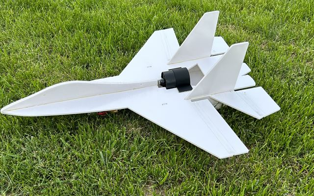
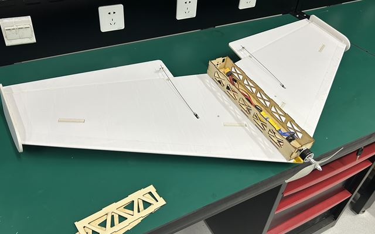
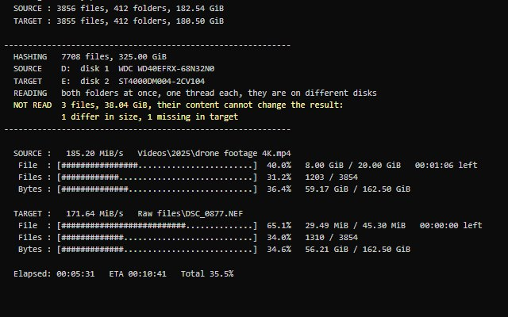

<!-- This page is generated from profile.json by scripts/build.mjs. Edit profile.json, not this file: changes here are overwritten. See EDITING.md. -->

## 📌 Projects

<table>
<tr>
<td width="50%" valign="top">

### [MazeSolver-Astar](https://github.com/chchaoo/MazeSolver-Astar)

Maze game in C++ with EasyX: guide the sheep home in 40 steps, with an A\* pathfinding Help button.
     

</td>
<td width="50%" valign="top">

### [lx04-flashing-guide](https://github.com/chchaoo/lx04-flashing-guide)

Step-by-step LX04 to X04G flashing guide, launcher and navigation setup.
  

</td>
</tr>
<tr>
<td width="50%" valign="top">

### [RCPlane-SU27](https://github.com/chchaoo/RCPlane-SU27)

Su-27 RC plane from one sheet of 5 mm foam board: DXF laser-cut plans, EDF and propeller versions, 15-minute build.
     

</td>
<td width="50%" valign="top">

### [Modified-FTVersaWing](https://github.com/chchaoo/Modified-FTVersaWing)

Modified Flite Test Versa Wing: foam-board flying wing with a laser-cut wooden FPV bay, DXF plans.
     

</td>
</tr>
<tr>
<td width="50%" valign="top">

### [sha256-folder-verify](https://github.com/chchaoo/sha256-folder-verify)

Verify that a copied folder is byte-for-byte identical to the original. One double-clickable .bat for Windows: SHA-256 of every file, full tree comparison, resumable, per-file progress.
      

</td>
<td width="50%" valign="top">

### [external-hdd-keepalive](https://github.com/chchaoo/external-hdd-keepalive)

Windows tools for external HDD disconnects: power settings, backup, restore and read-only keep-alive.
    

</td>
</tr>
</table>

Automatically ranked by stars, then forks, then latest update.

## ✈️ Plane plans at a glance

| | Material | Sheet | Board cost | Build time | Versions |
|---|---|---|---|---|---|
| [**Su-27**](https://github.com/chchaoo/RCPlane-SU27) | 5 mm foam board | 1100 / 1200 × 900 mm | ≈ ¥3 | ≈ 15 min | EDF · propeller |
| [**FT Versa Wing, modified**](https://github.com/chchaoo/Modified-FTVersaWing) | 5 mm foam board + 2 mm plywood | 1200 × 900 mm | ≈ ¥5 | ≈ 30 min | tractor · pusher · FPV |

## 🛤️ Build log

## 📊 By the numbers

## 🐍 Contributions

<picture>
  <source media="(prefers-color-scheme: dark)" srcset="https://raw.githubusercontent.com/chchaoo/chchaoo/output/github-snake-dark.svg">
  
</picture>
